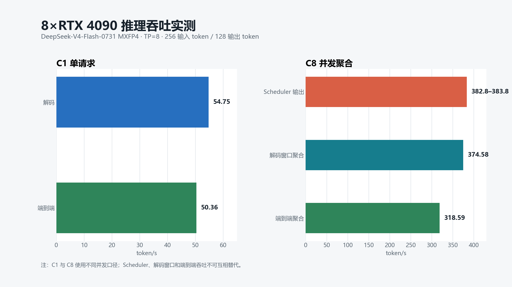
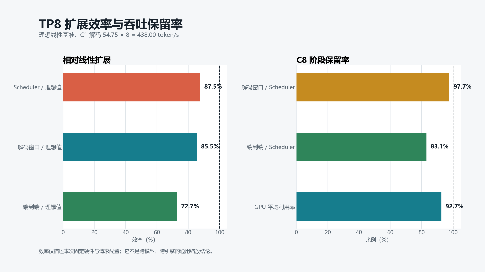
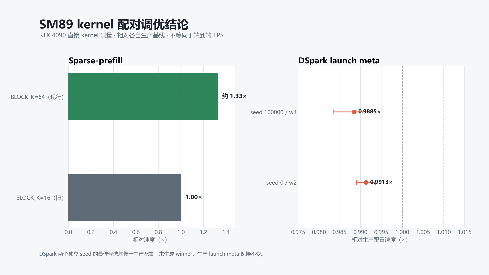

# DeepSeek-V4 Flash MXFP4：RTX 4090（SM89）专用推理分支

这是一个面向单机 **8×NVIDIA RTX 4090 24 GB** 的 SGLang 实验分支，目标是在
Ada SM89 架构上运行 `DeepSeek-V4-Flash-0731` MXFP4 权重，并针对 TP8 的
Attention、Indexer、MoE、CUDA Graph 和显存布局进行底层适配。

仓库只包含推理框架源码，不包含模型权重、JIT 缓存、基准请求、访问凭据或服务器
专用配置。

> [!WARNING]
> 当前版本是性能研究快照，不是生产版本。target-only 路径已能启动并完成性能测试，
> 请求槽与 SWA 页面复用已加入定向清理和 CPU 回归，但尚未重新完成 8 卡、多请求、
> 正反顺序的端到端压力验证；DSpark 也尚未通过严格逐 token 一致性验证。部署前请先
> 阅读[已知限制](#已知限制)。

## 项目概览

| 项目 | 当前状态 |
| --- | --- |
| 框架基线 | `d8f0ff966` + 2026-08-11 调优补丁 |
| 实验版本 | `v0.2.0-experimental` |
| 上游基线 | SGLang `131bd51b` |
| GPU 架构 | NVIDIA Ada SM89 |
| 已验证拓扑 | 8×RTX 4090 24 GB，TP=8 |
| 权重格式 | MXFP4 routed experts |
| KV Cache | FP8 E4M3 |
| 推荐模式 | target-only + decode full CUDA Graph |
| 开源许可 | Apache-2.0，继承自 SGLang |

## 底层适配内容

这个分支没有沿用面向 Hopper/Blackwell 的默认快速路径，而是补齐 SM89 所需的
运行时和 kernel 路由：

- 为 SM89 启用 MXFP4 Marlin MoE，并在加载阶段自动选择对应后端。
- 将稀疏 MLA decode 和 prefill 路由到 SM89 可执行的 Triton kernel。
- 增加面向 Ada launch geometry 的 BF16 sparse prefill kernel，并将配对实测胜出的
  `BLOCK_H=16, BLOCK_K=64, num_warps=8, num_stages=2` 固化为 SM89 配置。
- 固定 sparse decode 为 32-token tile、8 warps、2 stages，避免运行期 autotune
  临时申请显存导致 OOM。
- TP8 下保留每个 rank 原生 8 个 query heads，不再填充到 FlashMLA 的 64-head
  布局。
- 避免 SM89 Indexer KV pool 的冗余拷贝。
- 为 FP8 Indexer 和 MHC prenorm 增加 SM89 fallback。
- 修复 DSpark draft model 的 fused shared-expert 权重加载。
- 将 DSpark schedule 的选取与 finalize 合并为逐请求 kernel，并为零预算、覆盖全部
  候选槽位的预算增加不排序路径；launch meta 仍以生产配置为准。
- 将离线 C4/C128 压缩状态池初始化为明确的空状态 sentinel。
- 在 request slot 重新分配时清理 C128 状态，在物理 SWA page 归还前清理 C4
  attention/indexer 状态，覆盖普通 allocator 与 HiCache 回滚入口。

查看完整补丁序列：

```bash
git log --oneline 131bd51b..HEAD
```

## 性能实测

测试环境为单机 8×RTX 4090 24 GB、TP=8、上下文长度 8192、最大并发请求数 8、
decode full CUDA Graph，并关闭 custom all-reduce。下列数据只代表这一组固定硬件、
软件和请求配置，不是通用 SGLang 性能结论。

| 场景 | 指标 | 结果 |
| --- | --- | ---: |
| C1 | 解码吞吐 | 54.75 token/s |
| C1 | 端到端吞吐 | 50.36 token/s |
| C1 | 首 token 延迟（TTFT） | 0.222 s |
| C8 | Scheduler 输出吞吐 | 382.8–383.8 token/s |
| C8 | 解码窗口聚合吞吐 | 374.58 token/s |
| C8 | 端到端聚合吞吐 | 318.59 token/s |
| C8 | GPU 平均利用率 | 约 92.7% |



以 C1 解码吞吐 `54.75×8=438.00 token/s` 作为理想线性参考：

- C8 Scheduler 输出达到理想值的约 **87.5%**。
- C8 解码窗口聚合吞吐达到理想值的约 **85.5%**。
- C8 端到端聚合吞吐达到理想值的约 **72.7%**。
- 解码窗口相对 Scheduler 输出保留约 **97.7%**。
- 端到端吞吐相对 Scheduler 输出保留约 **83.1%**。



基准使用 256 个输入 token、128 个输出 token、greedy sampling、
`ignore_eos=true`，C8 请求通过 barrier 同时发射。比较其他引擎时必须保持
Scheduler、decode-window 和端到端三种统计口径一致。

图表可通过下列命令重新生成：

```bash
python scripts/generate_readme_charts.py
```

## Kernel 配对调优

这一轮测量只比较同一 kernel 的旧/现行配置或 DSpark launch meta，不把结果冒充为
整模型 TPS。候选会先完成 JIT 和精确 parity，再按确定性随机顺序执行 AB/BA 配对；
只有几何平均、95% 置信区间下界和最差 case 同时过门槛才会生成 winner。

| 组件 | 对比 | 配对结果 | 决策 |
| --- | --- | ---: | --- |
| Sparse-prefill | `BLOCK_K=16` → `64` | 约 `1.33×` | 已应用 |
| DSpark，seed 0 | `bc64-bcp256-w2` / 生产配置 | `0.991327×`，95% CI `[0.989033, 0.993626]` | 不应用 |
| DSpark，seed 100000 | `bc64-bcp256-w4` / 生产配置 | `0.988452×`，95% CI `[0.983479, 0.993449]` | 不应用 |



两组 DSpark 独立测量均返回 `no_improvement`，且未生成 winner 文件，因此没有把
“候选中最快”误当成“快于生产”。可复核数据位于
[`kernel-tuning-20260811.json`](docs/benchmarks/sm89/kernel-tuning-20260811.json)。
调优器可独立运行：

```bash
CUDA_VISIBLE_DEVICES=0 python benchmark/kernels/deepseek/tune_dspark_schedule_sm89.py \
  --source . \
  --output /tmp/dspark-sm89 \
  --case-set representative \
  --warmup 4 \
  --iters 20 \
  --timing-min-ms 10 \
  --timing-max-ms 30
```

## 运行环境

需要与当前 SGLang `main` 兼容的 Linux CUDA 环境。已验证环境使用：

- Python 3.10
- CUDA 13 用户态库
- 与 CUDA ABI 匹配的 PyTorch
- Triton 与 TVM-FFI JIT
- 与 CUDA ABI 匹配的 SGLang kernel wheel

先根据 [SGLang 官方文档](https://docs.sglang.ai/)准备基础环境，再通过
`PYTHONPATH` 使用本仓库源码：

```bash
git clone https://github.com/xltzsoft/deepseek-v4-sm89.git
cd deepseek-v4-sm89

export PYTHONPATH="$PWD/python"
export TORCH_CUDA_ARCH_LIST=8.9
export CUDA_MODULE_LOADING=LAZY
export CUDA_VISIBLE_DEVICES=0,1,2,3,4,5,6,7
```

模型权重需要从 ModelScope 或 Hugging Face 单独下载。请将 `MODEL_PATH` 指向
本地 `DeepSeek-V4-Flash-0731` MXFP4 快照目录，并遵守模型自身的许可条款。

## 启动服务

已验证的 target-only 启动参数如下：

```bash
export MODEL_PATH=/path/to/DeepSeek-V4-Flash-0731

python -m sglang.launch_server \
  --model-path "$MODEL_PATH" \
  --host 127.0.0.1 \
  --port 31000 \
  --tp-size 8 \
  --context-length 8192 \
  --max-running-requests 8 \
  --max-total-tokens 8192 \
  --max-prefill-tokens 8192 \
  --chunked-prefill-size -1 \
  --mem-fraction-static 0.92 \
  --swa-full-tokens-ratio 1.0 \
  --kv-cache-dtype fp8_e4m3 \
  --attention-backend dsv4 \
  --moe-runner-backend marlin \
  --cuda-graph-backend-decode full \
  --cuda-graph-backend-prefill disabled \
  --cuda-graph-max-bs-decode 8 \
  --disable-custom-all-reduce
```

除非已经配置认证和网络访问控制，否则不要把服务直接绑定到公网地址。

## 回归验证

SM89 补丁包含 backend 选择、原生 head geometry、sparse prefill、DSpark
shared-expert 加载、schedule、launch config 和压缩状态生命周期等定向测试：

```bash
pytest -q \
  test/registered/attention/unittests/dsv4/test_deepseek_v4_sm89.py \
  test/registered/kernels/ops/attention/test_sparse_prefill_bf16_sm89.py \
  test/registered/unit/kernels/test_flash_mla_sm89_config.py \
  test/registered/unit/mem_cache/test_deepseek_v4_compress_state_init.py \
  test/registered/unit/mem_cache/test_deepseek_v4_state_lifecycle.py \
  test/registered/unit/models/test_deepseek_v4_dspark_weight_loading.py \
  test/registered/unit/models/test_deepseek_v4_sm89_head_padding.py \
  test/registered/spec/dspark/test_dspark_scheduler.py \
  test/registered/spec/dspark/test_tune_dspark_schedule_sm89.py
```

本次发布分别通过 DSpark 调优器纯 CPU 单元测试 `18 passed`、远端生命周期回归
`6 passed`，以及远端 DSpark scheduler CPU 回归 `26 passed`。三组结果来自不同测试命令，
不合并成一个总数。

部署验证至少应包含两次冷启动，并以正序和反序重复执行同一组 greedy 请求。
必须逐 token 对比 `output_ids`，不能只比较解码文本或 speculative acceptance rate。

## 已知限制

1. **压缩状态生命周期仍需 GPU 压力验证。** 当前补丁已经按 request slot generation
   清 C128，并在物理 SWA page 释放前清 C4 attention/indexer，CPU 回归覆盖槽位隔离、
   online MTP draft bank 与清理顺序；真实 CUDA stream、HiCache 往返和 8 卡正反请求顺序
   尚未完成端到端复验。
2. **当前不建议启用 DSpark。** 修复后 DSpark 可以在每卡 24 GB 内完成加载和启动，
   但 greedy 输出没有通过 target reference 的逐 token 一致性验证，且两组独立
   launch-meta 配对搜索都没有找到快于生产配置的候选。
3. **仓库不分发模型权重。** 使用者需自行获取权重并遵守其许可证和使用条款。
4. **性能结果适用范围有限。** 驱动、CUDA/PyTorch 版本、GPU 时钟与温度、prompt
   分布和 batching 策略都会显著影响吞吐。

## 上游与许可

本项目派生自 [sgl-project/sglang](https://github.com/sgl-project/sglang)。仓库保留
原始版权声明与 Apache-2.0 许可证，本分支修改同样按照该许可证发布。
